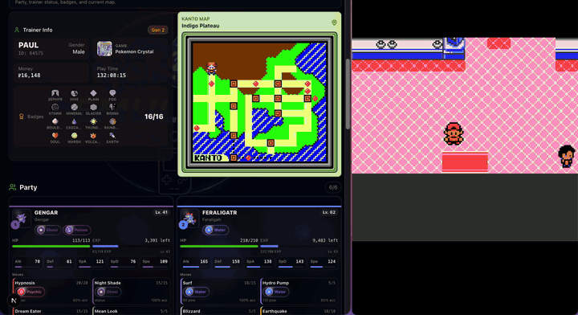
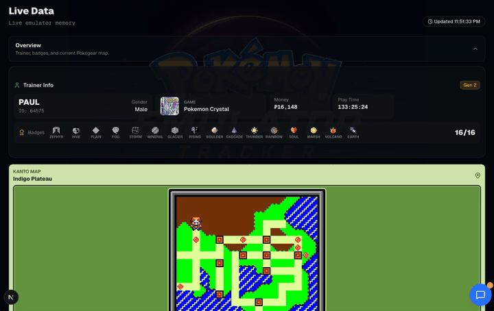
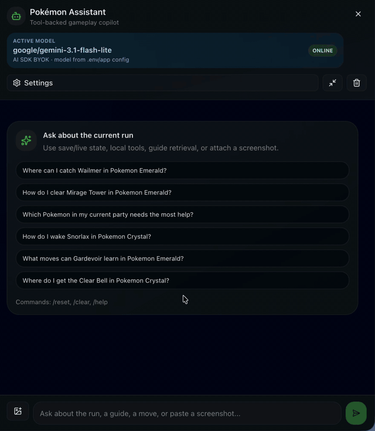

# Pokemon Emulator Tracker

<p align="center">
  
</p>

<p align="center">
  <strong>Inspect Pokemon save files, follow mGBA live memory, and query the current run with a tool-backed LLM.</strong>
</p>

<p align="center">
  <a href="https://github.com/paulthemagno/pokemon-emulator-tracker">
    
  </a>
  <a href="https://pokemon-emulator-tracker.vercel.app/">
    
  </a>
</p>

<p align="center">
  
  
  <a href="#connect-your-agent-mcp"></a>
  
  
</p>

<p align="center">
  <a href="#dashboard-overview">Overview</a> •
  <a href="#quick-start">Quick Start</a> •
  <a href="#save-file-workflow">Save Files</a> •
  <a href="#live-emulator-workflow">Live mGBA</a> •
  <a href="#connect-your-agent-mcp">Connect your agent</a> •
  <a href="#llm-assistant">LLM Assistant</a>
</p>

<p align="center">
  
</p>

Pokemon Emulator Tracker is a local-first dashboard for Pokemon emulator runs. It turns save files and live mGBA memory into a readable trainer dashboard: party, HP, boxes, inventory, badges, Pokedex, map location, story flags, and current progress.

It supports two main workflows:

- **Save files:** upload `.sav`, `.srm`, `.sa1`, `.sa2`, `.sn1`, or `.sn2` files and inspect the run.
- **Live emulator tracking:** connect mGBA through a local Lua adapter and watch the dashboard update while the game is running.

An optional Ollama, OpenRouter, or BYOK assistant can answer questions about the currently loaded save or live session.
**Already use Codex, Claude Code, or another local MCP client? [Connect your agent](#connect-your-agent-mcp)** to ask about your team, PC boxes, items, and progress directly in its chat. No model API key needs to be entered into this app.

## Contents

- [Dashboard Overview](#dashboard-overview)
- [Quick Start](#quick-start)
- [Connect Your Agent (MCP)](#connect-your-agent-mcp)
- [Supported Games](#supported-games)
- [Save File Workflow](#save-file-workflow)
- [Live Emulator Workflow](#live-emulator-workflow)
- [LLM Assistant](#llm-assistant)
- [Test and Audit](#test-and-audit)
- [Data Sources](#data-sources)
- [Project Docs](#project-docs)

## Dashboard Overview

<p align="center">
  
</p>

## Quick Start

Requires Node.js and Corepack.

The header displays the app version from `package.json`. Increment its `version`
field for each release; the UI uses that value automatically on the next build.

```bash
corepack enable
corepack pnpm install
corepack pnpm dev
```

Open:

```text
http://localhost:3000
```

You can also try the hosted UI: [pokemon-emulator-tracker.vercel.app](https://pokemon-emulator-tracker.vercel.app/).

The hosted demo supports save upload and UI browsing. Live mGBA mode and local Ollama stay local-only because Vercel cannot reach services running on your machine. Hosted chat can use OpenRouter or AI SDK BYOK when an API key is configured or entered for the session.

For production deployments, set `NEXT_PUBLIC_SITE_URL` to the canonical public
origin. The app uses it for canonical, Open Graph, `robots.txt`, and
`sitemap.xml` URLs. To verify the site with Google Search Console, optionally set
`GOOGLE_SITE_VERIFICATION` to the verification token supplied by Google.

<details>
<summary>Install and LAN notes</summary>

If `pnpm install` fails because build scripts were blocked:

```bash
corepack pnpm approve-builds --all
corepack pnpm install
```

To expose the UI on your LAN:

```bash
corepack pnpm dev --hostname 0.0.0.0
```

Then open the host machine IP, for example:

```text
http://192.168.1.83:3000
```

</details>

## Connect Your Agent (MCP)

Use your existing agent's chat as a Pokemon companion. The local MCP server exposes the same read-only tools as the built-in assistant, including the selected save/live state and local Pokemon reference data. Your agent handles the model and its own account requirements; the tracker does not require an LLM API key for this connection.

1. Follow [Quick Start](#quick-start) and keep the app running locally.
2. Open **http://localhost:3000** and **upload a save** or [start live mGBA tracking](#live-emulator-workflow). Keep that page open; MCP follows the game selected there.
3. In a second terminal, **from the repository root**, run the command for your installed client below. These examples use a macOS/Linux shell and save absolute paths to this checkout.

**Codex**

```bash
codex mcp add pokemon-tracker -- node --import "$(pwd)/node_modules/tsx/dist/loader.mjs" "$(pwd)/scripts/pokemon-mcp.ts"
```

Check registration with `codex mcp list`.

**Claude Code**

```bash
claude mcp add --transport stdio pokemon-tracker -- node --import "$(pwd)/node_modules/tsx/dist/loader.mjs" "$(pwd)/scripts/pokemon-mcp.ts"
```

Check the connection with `/mcp` inside Claude Code. This registers it for your local project.

**Other clients that support local stdio MCP**

Add a server named `pokemon-tracker` in your client's MCP settings:

```json
{
  "mcpServers": {
    "pokemon-tracker": {
      "command": "node",
      "args": [
        "--import",
        "/absolute/path/to/pokemon-emulator-tracker/node_modules/tsx/dist/loader.mjs",
        "/absolute/path/to/pokemon-emulator-tracker/scripts/pokemon-mcp.ts"
      ]
    }
  }
}
```

Replace both paths with your checkout's absolute paths. On Windows, use forward slashes such as `C:/projects/pokemon-emulator-tracker/...`. The JSON wrapper/settings location depends on your client. If a desktop client cannot find `node`, use its absolute executable path in `command`.

Reload your client's MCP connections or start a new chat if the tools do not appear. Then ask:

> Use pokemon-tracker to read my current game. Show my party and money, say whether the data comes from a save file or live memory, and report its age.

Uploaded saves are static until re-uploaded. Live selections refresh when queried; cached live readings are labelled and require `allowStale: true` to inspect. The hosted demo and cloud-only clients cannot connect to this local stdio server. You do not need to open the built-in **Chat AI** or run the MCP process manually: your client launches it.

If no game is selected, focus the tracker tab and load a save or enable **Start Live**. For a different port, troubleshooting, and tool details, see [Local MCP companion](docs/local-mcp.md). Client setup references: [Codex MCP](https://developers.openai.com/codex/mcp/) and [Claude Code MCP](https://code.claude.com/docs/en/mcp).

## Supported Games

| Generation | Games | Save upload | mGBA live |
| --- | --- | --- | --- |
| Gen 1 | Red, Blue, Yellow | Supported | Supported |
| Gen 2 | Gold, Silver, Crystal | Supported | Supported |
| Gen 3 | Ruby, Sapphire, Emerald | Fully supported | Fully supported |
| Gen 3 | FireRed, LeafGreen | Fully supported | Fully supported |

See [docs/game-support-matrix.md](docs/game-support-matrix.md) for the detailed support matrix and current caveats.

## Save File Workflow

1. Start the app locally or open the hosted demo.
2. Drag a `.sav`, `.srm`, `.sa1`, `.sa2`, `.sn1`, or `.sn2` file into the upload area.
3. Inspect trainer data, party, Pokédex, PC boxes, inventory, badges, and map.
4. Re-upload the save after saving in-game to refresh the dashboard.

The parser identifies the save format from its contents and validates checksums.
Names in English, Italian, German, French and Spanish can resolve titles within
that format, but cannot force an incompatible parser. A file named `unlabeled.sav`
works too: if the save only identifies a pair (Red/Blue, Gold/Silver,
Ruby/Sapphire or FireRed/LeafGreen), choose the exact game in the prompt.
Saves with unsupported or damaged layouts produce an error instead of defaulting
to Red or Ruby. Japanese/Korean save layouts are not supported yet.

The parser normalizes uploaded saves into the same model used by live mode, so the UI behaves the same after upload or live polling.

## Live Emulator Workflow

Live mode requires the app to run locally.

1. Start the app with `corepack pnpm dev`.
2. Open the game in mGBA.
3. In mGBA, open `Tools -> Scripting...`.
4. Load the Lua adapter for your game.
5. Keep the script running.
6. In the web app, press **Start Live**.

| Games | Lua adapter |
| --- | --- |
| Red, Blue, Yellow | `live-adapters/mgba-gen1-live.lua` |
| Gold, Silver, Crystal | `live-adapters/mgba-gen2-live.lua` |
| Ruby, Sapphire, Emerald, FireRed, LeafGreen | `live-adapters/mgba-gen3-live.lua` |

The Lua adapter serves:

```text
http://127.0.0.1:8080/snapshot
```

The web app calls:

```text
GET /api/live
```

which proxies to the local Lua server.

If you change a Lua script or any file under `live-adapters/generated/`, reload the script in mGBA. If live polling is stopped, the dashboard falls back to the uploaded save file.

More details and debug endpoints: [live-adapters/README.md](live-adapters/README.md).

## LLM Assistant

The chat assistant is optional. It can use local Ollama, OpenRouter, or AI SDK BYOK and receives a compact context from the current save/live session: trainer, party, inventory, badges, location, Pokédex progress, and related local knowledge.

<p align="center">
  
</p>

The assistant supports three provider modes:

| Mode | Connection | Minimum setup |
| --- | --- | --- |
| **Ollama** | Fully local Ollama endpoint | Run Ollama, pull a model, and use `CHAT_PROVIDER=ollama` |
| **OpenRouter** | Hosted models through the OpenRouter gateway | Set `OPENROUTER_API_KEY`, `OPENROUTER_MODEL`, and `CHAT_PROVIDER=openrouter` |
| **AI SDK / BYOK** | Native Anthropic, OpenAI, or Google APIs through Vercel AI SDK | Set `AI_SDK_MODEL=provider/model`, provide the matching vendor key, and use `CHAT_PROVIDER=ai-sdk` |

The demo above uses **AI SDK / BYOK** with Google Gemini. Set the default through
`CHAT_PROVIDER`, or switch provider, model, and request API key from **Chat AI → Settings**
for the current page session.

For every mode, start the app, load a save or start live mode, then open **Chat AI**.
The assistant opens as a right-side drawer on desktop, resizing the dashboard while it is
visible; on smaller screens it behaves like a bottom sheet.

<details>
<summary>Local Ollama setup</summary>

1. Install Ollama and pull the default model:

```bash
ollama pull gemma4:latest
```

2. Start Ollama:

```bash
ollama serve
```

3. Start the app:

```bash
corepack pnpm dev
```

</details>

If the selected Ollama model does not support tool calls, the app falls back to prompt/context mode. OpenRouter and AI SDK BYOK use the same tool registry through provider tool-calling APIs.

<details>
<summary>LLM configuration</summary>

Optional environment variables:

```bash
CHAT_PROVIDER=ollama
CHAT_MAX_TOKENS=-1
CHAT_TEMPERATURE=0
CHAT_THINKING=true
CHAT_ENABLE_TOOLS=true

OLLAMA_ENDPOINT=http://127.0.0.1:11434
OLLAMA_MODEL=gemma4:latest
OLLAMA_EMBEDDING_MODEL=embeddinggemma:latest
OLLAMA_API_KEY=
OLLAMA_ALLOW_RUNTIME_ENDPOINT=false

OPENROUTER_API_KEY=
OPENROUTER_BASE_URL=https://openrouter.ai/api/v1
OPENROUTER_MODEL=google/gemini-2.5-flash-lite

AI_SDK_API_KEY=
AI_SDK_MODEL=anthropic/claude-sonnet-4-5
```

`CHAT_PROVIDER` selects the server default provider. The chat settings panel can
override the provider, model, Ollama endpoint, and request API key for the
current page session. Blank fields use the server environment values, and
request API keys are not stored in conversation history. Remote Ollama endpoint
overrides require `OLLAMA_ALLOW_RUNTIME_ENDPOINT=true`.

`CHAT_MAX_TOKENS` and `CHAT_TEMPERATURE` are shared defaults for all chat
providers. `CHAT_THINKING` is the shared thinking/reasoning default for
providers that expose a compatible control. Set `CHAT_ENABLE_TOOLS=false` to
disable tool calling for every provider and use prompt/context mode. Provider-specific overrides are
still supported when you need them: `OLLAMA_MAX_TOKENS`,
`OPENROUTER_MAX_TOKENS`, `AI_SDK_MAX_TOKENS`, `OLLAMA_TEMPERATURE`,
`OPENROUTER_TEMPERATURE`, `AI_SDK_TEMPERATURE`, `OLLAMA_THINKING`, and
`AI_SDK_REASONING`.

`CHAT_PROVIDER=ai-sdk` enables BYOK routing through Vercel AI SDK. Enter a model
as `provider/model`, for example `anthropic/claude-sonnet-4-5`,
`openai/gpt-4.1`, or `google/gemini-2.5-flash`. The API key must match the
provider prefix.

`OLLAMA_EMBEDDING_MODEL` selects the Ollama embedding model used by guide RAG
generation and runtime vector retrieval. It has no hidden default; set it before
generating embeddings. If you change it, regenerate the static guide embeddings
so document and query vectors are produced by the same model:

```bash
corepack pnpm generate:pokemon-guide-embeddings
```

JPEG, PNG, and WebP attachments work with vision-capable Ollama, OpenRouter, or AI SDK
models. Add them with the image button or paste an image directly into the chat input.
Audio notes require a separate speech-to-text step and are not accepted yet.
Attached images are rendered in the chat and stored with the client-side
conversation. Models that expose Ollama thinking or AI SDK reasoning can stream
it into a collapsible panel. Disable **Model thinking** in chat settings, set
`CHAT_THINKING=false`, `OLLAMA_THINKING=false`, or `AI_SDK_REASONING=false` to
request only the final answer where the selected provider supports disabling
reasoning.

</details>

Details: [docs/llm-pokemon-agent.md](docs/llm-pokemon-agent.md).

## Test and Audit

```bash
corepack pnpm test
corepack pnpm audit:pokemon-data
```

Before promoting a new game to fully supported, update the support matrix and add fixtures/tests.

## Data Sources

Pokemon data should stay local at runtime and have traceable sources. Generated files under `lib/pokemon/knowledge/` and `live-adapters/generated/` should not be edited by hand.

Source manifests:

```text
lib/pokemon/knowledge/sources/
```

Generated outputs:

```text
lib/pokemon/knowledge/
live-adapters/generated/gen1-live-offsets.lua
live-adapters/generated/gen2-live-offsets.lua
live-adapters/generated/gen3-live-offsets.lua
```

Regenerate:

```bash
corepack pnpm generate:pokemon-knowledge
```

Source policy and pins:

- [docs/pokemon-source-policy.md](docs/pokemon-source-policy.md)
- [docs/source-lockfile.md](docs/source-lockfile.md)

Event descriptions combine pinned PRET source occurrences with reviewed walkthrough references from `lib/pokemon/knowledge/sources/game-guide-sources.json`.

## Project Docs

- [docs/local-mcp.md](docs/local-mcp.md): connecting external agents via MCP, freshness, and available tools.
- [live-adapters/README.md](live-adapters/README.md): using and debugging the mGBA scripts.
- [docs/architecture.md](docs/architecture.md): stable technical data flow.
- [docs/game-support-matrix.md](docs/game-support-matrix.md): per-game support status.
- [docs/known-issues.md](docs/known-issues.md): open limitations.
- [docs/llm-pokemon-agent.md](docs/llm-pokemon-agent.md): local assistant tools, retrieval, and provider behavior.
- [docs/pokemon-source-policy.md](docs/pokemon-source-policy.md): source standards for Pokemon data.
- [docs/source-lockfile.md](docs/source-lockfile.md): sources, pins, and offset notes.
- [docs/progress-facts-prototype.md](docs/progress-facts-prototype.md): generated audit report for reviewed progress facts.
- [AGENTS.md](AGENTS.md): operational notes for Codex/agents.
